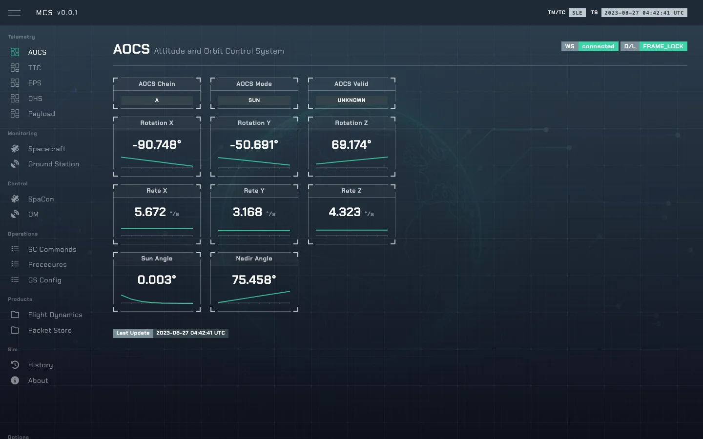

# AOCS — Attitude and Orbit Control

`AOCSMin` in [`so/sys/aocs.py`](../sim-ops-ng-lib/so/sys/aocs.py). First in the chain: it
propagates the orbit everything else uses. Bus name `aocs`.

---

## 1. State

| Field | Type | Default | Meaning |
|---|---|---|---|
| `aocs_mode` | `AOCSTarget` | `NADIR` | `SUN`, `TARGET`, `NADIR` (plus `RATEDAMPING`, `MONITORING` in the enum). |
| `aocs_chain` | `A`/`B` | `A` | Redundant chain in use. |
| `aocs_valid` | `Status` | `unknown` | Sensor calibration: `valid`, `not_valid`, `unknown`. |
| `aocs_rotation`, `aocs_rates` | `[3]` deg | 0 | Attitude and rates. |
| `aocs_sun_angle`, `aocs_nadir_angle` | deg | 0 | |
| `aocs_position` | `[lat, lon, alt]` | 0 | Sub-satellite point. |
| `aocs_damp` | 0–1 | 1 | Settling factor after a mode change. |

---

## 2. Commands

| Control | Values | TC |
|---|---|---|
| `aocs_mode` | `SUN`, `TARGET`, `NADIR` | `TC_AOCS_001`–`003` |
| `aocs_chain` | `A`, `B` | `TC_AOCS_011`, `012` |
| `aocs_valid` | `valid`, `not_valid`, `unknown` | `TC_AOCS_021` (calibrate → `valid`) |

`TC_EPS_041` (power cycle AOCS) resets `aocs_valid` to `unknown`. Safe mode and EPS/DHS chain swaps
force `aocs_mode` to `SUN`.
