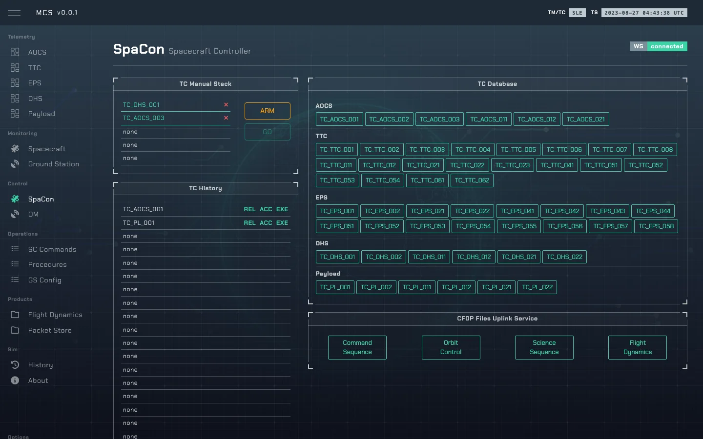
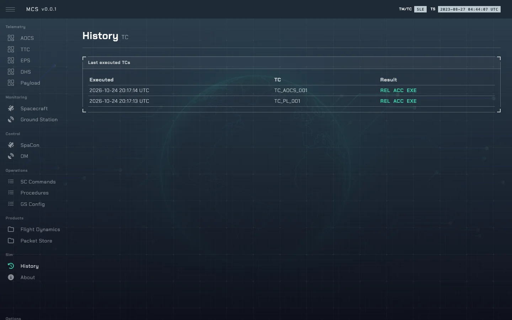

# Commanding

How a TC gets from the MCS to a subsystem and how to read the acknowledgement. Code:
`SimOps._do_control()` in [`so/core.py`](../sim-ops-ng-lib/so/core.py), `SpacecraftSim.control()`
and `CommunicationBus` in [`so/spacecraft.py`](../sim-ops-ng-lib/so/spacecraft.py).

---

## 1. The path of a command

```
MCS SpaCon ──▶ POST /api/tc-stack         (push, max 5 entries, shared by all operators)
           ──▶ POST /api/tc-stack/execute (run the head of the stack, FIFO)
           ──▶ POST /api/tc-stack/send    (file uploads: run the given TC)
                  │
             SimOps._do_control() ──▶ SpacecraftSim.control() ──▶ CommunicationBus.send()
                  │
             <subsystem>.command(state, BusMessage)
```

A stack entry is `{command, system, control, value}`, e.g. `TC_AOCS_001` setting `aocs_mode` =
`SUN`. Operators can only push catalogue TCs; controls that set internal state (e.g.
`eps_battery_dod`, `trigger_safe_mode`) are admin-only, via `/api/control`.

The control name's prefix picks the subsystem (`aocs_`, `ttc_`, `eps_`, `dhs_`, `pl_`);
`trigger_safe_mode` goes to the DHS. Every command is logged in the DHS TC history.



---

## 2. Acknowledgement format

`{rel}:REL {acc}:ACC {exe}:EXE` — **release** (ground), **acceptance** and **execution** (on
board), each prefixed with:

| Prefix | Meaning |
|---|---|
| `g` | Green — confirmed OK. |
| `w` | Warning (reserved; not currently produced). |
| `r` | Red — failed. |
| `u` | Unknown — no telemetry to confirm the outcome either way. |

`g:REL g:ACC g:EXE` is full success. `u` is not a failure: the command may have executed, there is
just no TM to prove it (e.g. no downlink frame lock).



---

## 3. High-priority commands (HPTC)

The only commands processed while the TTC MCU is in `error` (`HPTC` in `so/core.py`): all
`TC_TTC_*`, the EPS power cycles `TC_EPS_041`–`044` and the TTC TX/RX power switches
`TC_EPS_051`–`058`. Marked `(hp)` in the MCS catalogue.

---

## 4. Catalogue and ground-station controls

The catalogue lives in the MCS ([`Commands.vue`](../sim-ops-ng-mcs/src/views/Commands.vue),
[`SpaCon.vue`](../sim-ops-ng-mcs/src/views/SpaCon.vue)); effects are on each subsystem page.
Ground-station controls go straight to the ground station and answer `OK` or `FAIL`
([ground_station.md](ground_station.md#4-controls)).
