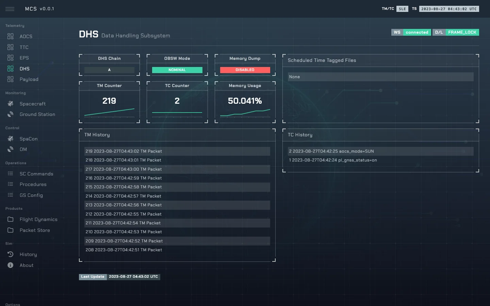

# DHS — Data Handling

`DHSMin` in [`so/sys/dhs.py`](../sim-ops-ng-lib/so/sys/dhs.py): OBSW mode, TM/TC counters and
logs, and mass memory. It includes a FDIR process, Bus name `dhs`.

---

## 1. State

| Field | Default | Meaning |
|---|---|---|
| `dhs_chain` | `A` | Redundant chain. |
| `dhs_obsw_mode` | `nominal` | `nominal` or `safe`. Payload commands need `nominal`. |
| `dhs_memory` | 50 | Mass memory fill, %. |
| `dhs_mem_dump_enabled` | false | |
| `dhs_tm_counter`, `dhs_tc_counter` | 0 | |
| `dhs_tm_window`, `dhs_tc_history` | `[]` | Rolling logs. |
| `dhs_uploaded` | `[]` | Items uploaded to the spacecraft (the last 10, oldest first). |

---

## 2. Commands

| Control | Values | TC |
|---|---|---|
| `dhs_chain` | `A`, `B` | `TC_DHS_001`, `002` — a swap forces OBSW safe and AOCS SUN |
| `dhs_obsw_mode` | `safe`, `nominal` | `TC_DHS_011`, `012` |
| `dhs_mem_dump_enabled` | `true`, `false` | `TC_DHS_021`, `022` |
| `dhs_memory` | 0–100 | — (instructor) |
| `dhs_uploaded` | any | — appends to `dhs_uploaded`, dropping the oldest beyond 10 |
| `trigger_safe_mode` | — | — (instructor, link-independent) |
