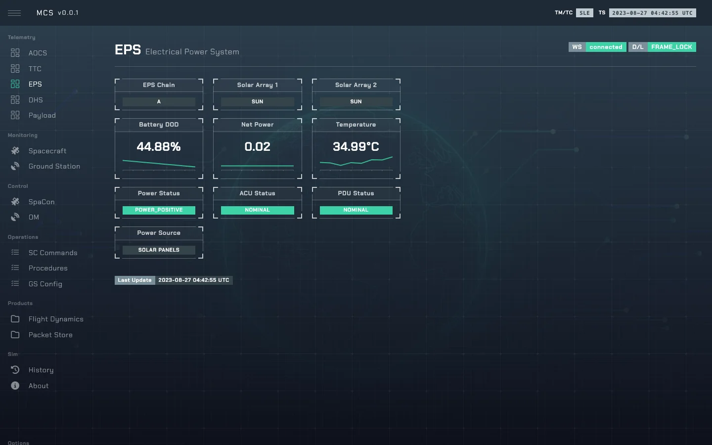

# EPS — Electrical Power

`EPSMin` in [`so/sys/eps.py`](../sim-ops-ng-lib/so/sys/eps.py): power balance, battery depth of
discharge, temperature and TTC power switching. Bus name `eps`.

---

## 1. State

| Field | Default | Meaning |
|---|---|---|
| `eps_chain` | `A` | Redundant chain. |
| `eps_net_power` | 0 | Net power balance. |
| `eps_sol_array` | `[no_sun, no_sun]` | Illumination of the two arrays. |
| `eps_battery_dod` | 50 | Depth of discharge, %. |
| `eps_temperature` | 40 | °C. |
| `eps_acu` | `nominal` | Array conditioning unit; `control_err` cuts array power. |
| `eps_pdu` | `nominal` | Power distribution unit. |
| `eps_power_status` | `power_negative` | Derived. |
| `eps_power_source` | `S` | `S` solar, `R` RTG. |

---

## 2. Commands

| Control | Values | TC |
|---|---|---|
| `eps_chain` | `A`, `B` | `TC_EPS_001`, `002` — a swap forces OBSW safe and AOCS SUN |
| `eps_sol_array_1_reset`, `eps_sol_array_2_reset` | — | `TC_EPS_021`, `022` — acknowledged only |
| `eps_power_cycle_aocs` | — | `TC_EPS_041` (hp) — `aocs_valid` → `unknown` |
| `eps_power_cycle_ttc` | — | `TC_EPS_042` (hp) — `ttc_mcu` → `nominal` |
| `eps_power_cycle_acu` | — | `TC_EPS_043` (hp) — `eps_acu` → `nominal` |
| `eps_power_cycle_pdu` | — | `TC_EPS_044` (hp) — `eps_pdu` → `nominal` |
| `eps_ttc_s_tx`, `eps_ttc_s_rx` | `on`, `off` | `TC_EPS_051`–`054` (hp) |
| `eps_ttc_x_tx`, `eps_ttc_x_rx` | `on`, `off` | `TC_EPS_055`–`058` (hp) |
| `eps_battery_dod` | number | — (instructor) |
