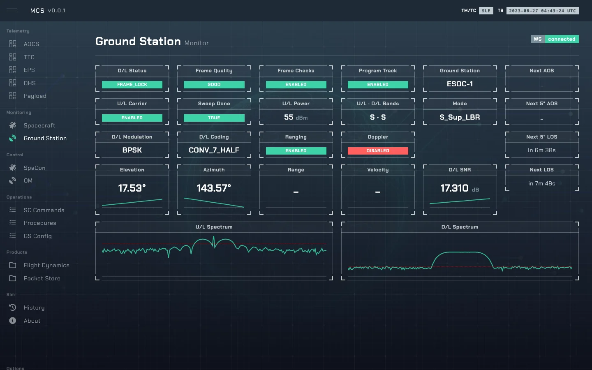

# Ground station

Pass prediction, antenna tracking, the downlink side of the RF link, lock states and spectra.
Code: [`so/ground_station.py`](../sim-ops-ng-lib/so/ground_station.py) (`GroundStationSim`,
`SpectrumGenerator`).

It computes the **downlink** budget (`_calc_link_budget_dl`); the TTC computes the uplink
([ttc.md](ttc.md)); both follow [rf_link.md](rf_link.md). `band_ul` is independent of the downlink
mode (S up with X down is allowed).

---

## 1. Passes and tracking

On construction, skyfield finds the day's passes over the station at 0° and 5° (`next_pass_*`,
`next_5_*`). With **program track** on, each tick in a pass computes elevation, azimuth, range and
range-rate (`doppler_velocity`); otherwise they are `None` and there is no link.

---

## 2. Lock states

Downlink `status_dl` and uplink `ttc_state_ul` both climb the `TTCState` ladder `NO_RF →
RF_DETECTED → PLL_LOCK → PSK_LOCK → BIT_LOCK → FRAME_LOCK` by link margin; the thresholds are in
[rf_link.md](rf_link.md#7-from-margin-to-lock-state). The uplink only locks after a sweep. A
ground/spacecraft mode mismatch gives downlink `NO_RF`, though the spectrum still shows the signal.
In `SLE` mode telemetry needs downlink `FRAME_LOCK`; commands need carrier and sweep.

Housekeeping each tick (`_update_wrap_up`): the uplink carrier drops below 5°; below the horizon the
uplink state, sweep and frame quality reset; Doppler compensation needs PLL lock both ways; the
sweep is lost when the carrier goes off or the uplink margin falls to −1 dB or below.

---

## 3. Flight dynamics

With program track, a sample `[x, y, z, range, range-rate]` is recorded every 10 s. Range needs
**auto range** and spacecraft ranging; range-rate needs **Doppler** and a coherent transponder. At
pass end (or breakpoint change) the samples go to MinIO as one product, `validity` 0–2 by how many
of the two were collected. They are not broadcast.

---

## 4. Controls

`GroundStationSim.control()` answers `OK` or `FAIL`:

| Control | Values | Notes |
|---|---|---|
| `carrier_ul` | `on` / `off` | `on` only at ≥ 5° elevation. |
| `sweep` | `true` / `false` | Needs the carrier on. |
| `power_ul` | dBm, 0–70 | Commands need ≥ 50. |
| `mode` | a `TTCModes` name | Must match the spacecraft's for downlink lock. |
| `band_ul` | `S` / `X` | Not while the carrier is on; a change clears the sweep. |
| `program_track`, `auto_track`, `auto_range`, `doppler_enabled` | `true` / `false` | |
| `frame_checks` | `enabled` / `disabled` | |

---

## 5. Spectra

`SpectrumGenerator` synthesises `spectrum_ul` / `spectrum_dl` from modulation, bandwidth, Eb/N0
and Doppler. The instructor can override downlink results ([admin.md](admin.md#2-overrides),
[rf_link.md](rf_link.md#8-instructor-overrides)).
