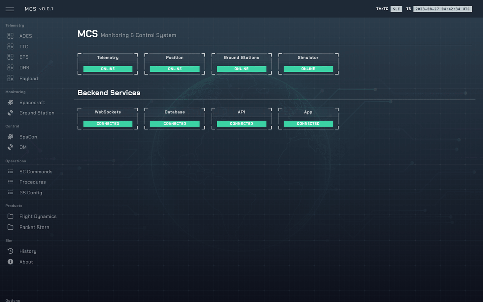

# sim-ops-ng — spacecraft operations simulator

An environment for **spacecraft operations exercises**: a simulated spacecraft on a real orbit,
a ground station, and a Monitoring and Control System (MCS) where the Flight Control Team (FCT)
manages the spacecraft.
An admin panel is used by the instructor to manage the sessions.

Based on [Sim-Ops](https://github.com/nunorc/sim-ops).



```
      fct                   instructor                 3D view
  ┌─────────┐              ┌──────────┐              ┌─────────┐
  │   MCS   │              │  admin   │              │   3dv   │
  │ (Vue 3) │              │ (Flask)  │              │(Cesium) │
  └────┬────┘              └────┬─────┘              └────┬────┘
       │ /api, /api/ws          │ /api, /api/ws/admin      │ /api/ws/viewer
  ═════╪════════════════════════╪══════════════════════════╪═════ nginx :8080
       └──────────────┬─────────┴──────────────────────────┘
                ┌─────┴──────┐
                │ SimOpsAPI  │ FastAPI, REST + WebSocket       :9111
                └─────┬──────┘
                      │ TCP socket: JSON commands + state    :5555
                ┌─────┴──────┐                     ┌──────────┐
                │   SimOps   │ ── TM/TC packets ──▶│  MinIO   │ :9000
                │  (engine)  │    FD products      └──────────┘
                └─────┬──────┘
          ┌───────────┴────────────┐
   GroundStationSim          SpacecraftSim
   tracking, RF link,        AOCS → TTC → EPS → DHS → Payload
   spectra, lock states
```

Engine and API are separate processes; frontends only talk to the API
([architecture.md](architecture.md)). To run it: [quickstart.md](quickstart.md).

---

## 1. Main components

| Component | Code | Reference |
|---|---|---|
| **Sim engine** — loop, scenario, TC stack, overrides | [`so/core.py`](../sim-ops-ng-lib/so/core.py) | [architecture.md](architecture.md), [sim_loop.md](sim_loop.md) |
| **Spacecraft** — five subsystems on a command bus | [`so/spacecraft.py`](../sim-ops-ng-lib/so/spacecraft.py), [`so/sys/`](../sim-ops-ng-lib/so/sys/) | [aocs.md](aocs.md), [ttc.md](ttc.md), [eps.md](eps.md), [dhs.md](dhs.md), [payload.md](payload.md) |
| **Ground station** — passes, tracking, lock states | [`so/ground_station.py`](../sim-ops-ng-lib/so/ground_station.py) | [ground_station.md](ground_station.md) |
| **RF link** — CCSDS link budget | [`so/rf_link.py`](../sim-ops-ng-lib/so/rf_link.py) | [rf_link.md](rf_link.md) |
| **API** — REST + WebSocket | [`so/api.py`](../sim-ops-ng-lib/so/api.py) | [api.md](api.md) |
| **Admin** — instructor panel | [`so/admin.py`](../sim-ops-ng-lib/so/admin.py) | [admin.md](admin.md) |
| **MCS** — operator frontend | [`sim-ops-ng-mcs/`](../sim-ops-ng-mcs/) | [mcs.md](mcs.md) |
| **3DV** — 3D orbit view | [`sim-ops-ng-3dv/`](../sim-ops-ng-3dv/) | [3dv.md](3dv.md) |

The Python package `so` lives in [`sim-ops-ng-lib/`](../sim-ops-ng-lib/) (managed with `uv`).

---

## 2. Repository layout

```
.
├── sim-ops-ng-lib/         Python backend, package `so` (uv)
│   ├── so/                 engine, API, admin
│   │   └── sys/            spacecraft subsystems: aocs, ttc, eps, dhs, payload
│   ├── bin/                entry points: sim-ops.py, sim-ops-api.py, admin.py, run-devel.sh, ws-client.py
│   ├── data/               scenarios (demo.json, testing.json) and trigger scripts
│   └── tests/              Python tests
├── sim-ops-ng-mcs/         MCS frontend (Vue 3 + TypeScript)
├── sim-ops-ng-3dv/         3D view (TypeScript + CesiumJS)
├── containers/             Dockerfiles and nginx config
├── docs/                   this documentation; site/ holds the Hugo site
├── bin/                    version.sh, release.sh
├── .github/workflows/      CI: lint, tests, builds, docs, release
├── docker-compose.yml      full stack on :8080
├── VERSION                 project version (source of truth)
└── CHANGELOG.md            release notes
```

More on each: scenarios in [scenarios.md](scenarios.md), triggers in
[admin.md](admin.md#3-triggers), tests in [testing.md](testing.md), containers in
[deployment.md](deployment.md), versioning and releases in [releasing.md](releasing.md).

---

## 3. Acknowledgements

Thanks to David Evans for the help and contributions with the design and behaviour of the
simulator, and to the [Sim-Ops](https://github.com/nunorc/sim-ops) team.

MCS UI theme based on HUD Vue by Sean Ngu.
