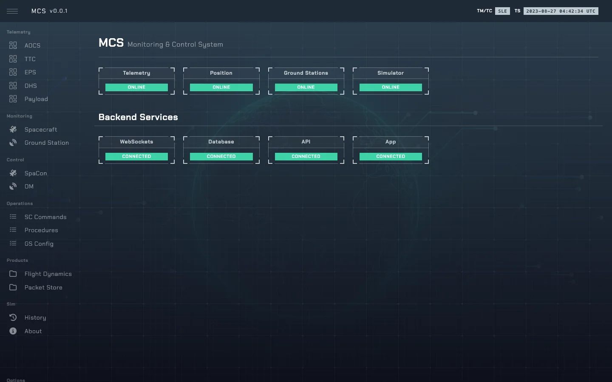

# MCS — Monitoring and Control System

The operators' frontend: Vue 3 + TypeScript, Pinia stores and Vue Router, in
[`sim-ops-ng-mcs/`](../sim-ops-ng-mcs/). Served at `/` behind nginx.



---

## 1. Data flow

Reads from the user WebSocket (`/api/ws`), commands over REST ([api.md](api.md)). In `SLE` mode
telemetry only arrives at downlink `FRAME_LOCK`; otherwise displays go stale and **Last Update**
shows their age. A dropped socket reconnects (1 s → 15 s back-off) behind a banner.

---

## 2. Stores

| Store | File | Holds |
|---|---|---|
| Socket | [`app-websockets.ts`](../sim-ops-ng-mcs/src/stores/app-websockets.ts) | The WebSocket, its connection `status` and reconnects, and the latest `sc_state`, `gs_state`, `sim_ts`, `tc_stack`, `tc_history`, `data_proxy` and `sle_connected`. |
| Auth | [`app-auth.ts`](../sim-ops-ng-mcs/src/stores/app-auth.ts) | The user password, in `sessionStorage` (per tab). A rejected password (socket closed with 1008, or `/api/auth` failing) re-prompts. |
| Options | [`app-option.ts`](../sim-ops-ng-mcs/src/stores/app-option.ts) | App options, including the API base URL (`VITE_SO_API`, empty = same origin). |

---

## 3. Views

Routes are in [`src/router/`](../sim-ops-ng-mcs/src/router/); views in
[`src/views/`](../sim-ops-ng-mcs/src/views/).

| Route | View | Purpose |
|---|---|---|
| `/` | `Dashboard.vue` | Overview. |
| `/aocs`, `/ttc`, `/eps`, `/dhs`, `/payload` | per subsystem | Subsystem telemetry. |
| `/spacecraft` | `Spacecraft.vue` | Spacecraft overview. |
| `/ground_station` | `GroundStation.vue` | Station state, lock status, spectra (`GroundStationPanel.vue`). |
| `/gs_config` | `GSConfig.vue` | Ground-station configuration. |
| `/spacon` | `SpaCon.vue` | Spacecraft controller: build and execute the TC stack. |
| `/om` | `OM.vue` | The same panel plus ground-station control: uplink carrier, sweep, power, bands, tracking. |
| `/commands` | `Commands.vue` | The command catalogue. |
| `/procedures` | `Procedures.vue` | Operational procedures. |
| `/flight-dynamics` | `FlightDynamics.vue` | Flight-dynamics products. |
| `/packet-store` | `PacketStore.vue` | Stored TM/TC space packets. |
| `/history` | `History.vue` | The last TCs executed from the shared stack, with their acknowledgement. |
| `/about` | `About.vue` | |

---

## 4. Development

```sh
$ cd sim-ops-ng-mcs
$ npm install
$ npm run dev          # Vite dev server
$ npm run build        # type check + production build
```

Lint and tests: [testing.md](testing.md#2-frontends). The dev server needs `VITE_SO_API` and
`VITE_WS_URL` in the root `.env`.

Shared pieces live in [`src/components/app/`](../sim-ops-ng-mcs/src/components/app/):
`TelemetryStatus` (the WS and D/L header badges), `LastUpdate` (the telemetry footer),
`ConnectionBanner`, `AckStatus` (a `g:REL g:ACC g:EXE` acknowledgement) and `GroundStationPanel`.

Every `<script>` is TypeScript (ESLint enforces `lang="ts"`), so `vue-tsc` checks the templates too.
The spacecraft and ground-station state types in
[`src/types/state.ts`](../sim-ops-ng-mcs/src/types/state.ts) are generated from the dataclasses in
`so/data_model.py`: after changing those, run `uv run bin/gen-ts-types.py` in `sim-ops-ng-lib`
(a lib test fails until the file is current). The subsystem views share
[`src/composables/spacecraft-view.ts`](../sim-ops-ng-mcs/src/composables/spacecraft-view.ts) for
their cached state and sparklines.

`apexcharts` is pinned to `4.7.0` for
[`patches/apexcharts+4.7.0.patch`](../sim-ops-ng-mcs/patches/apexcharts+4.7.0.patch), applied on
`postinstall` (another version fails the install). The fix is one character
(`"M 0 0"` → `"M 0 0 "`); the patch is large only because the bundles are minified. Re-create it
with `npx patch-package apexcharts` when upgrading.
