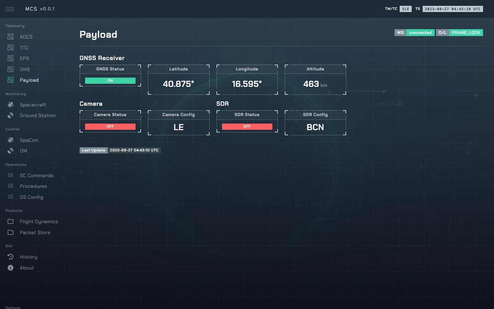

# Payload

`PayloadMin` in [`so/sys/payload.py`](../sim-ops-ng-lib/so/sys/payload.py): a GNSS receiver, a
camera and a software-defined radio. Bus name `pl`.

---

## 1. State

| Field | Default | Meaning |
|---|---|---|
| `pl_gnss_status` | `off` | |
| `pl_gnss_pos` | `[0, 0, 0]` | Last fix: lat, lon, alt. |
| `pl_camera_status` | `off` | |
| `pl_camera_config` | `LE` | |
| `pl_sdr_status` | `off` | |
| `pl_sdr_config` | `BCN` | |

---

## 2. Commands

Executed only with OBSW `nominal`, otherwise rejected (`r:EXE`). Marked `(nm)` in the catalogue.

| Control | Values | TC |
|---|---|---|
| `pl_gnss_status` | `on`, `off` | `TC_PL_001`, `002` |
| `pl_camera_status` | `on`, `off` | `TC_PL_011`, `012` |
| `pl_sdr_status` | `on`, `off` | `TC_PL_021`, `022` |

Safe mode switches all three off.
