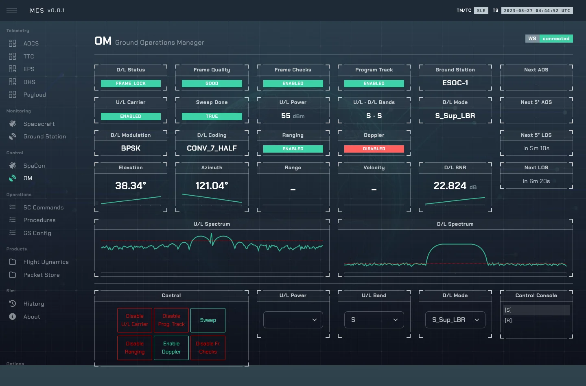

# Quickstart

## 1. Configure

```sh
$ cp .env.example .env
```

Defaults work locally; read [configuration.md](configuration.md) before exposing the stack.

---

## 2. Run with Docker

```sh
$ docker compose build
$ docker compose up -d
```

| URL | What | Password |
|---|---|---|
| http://localhost:8080 | MCS | `SIM_OPS_NG_USER_PASSWORD` (default `user123`) |
| http://localhost:8080/admin | Admin panel | `SIM_OPS_NG_ADMIN_PASSWORD` (default `admin123`) |
| http://localhost:8080/3dv | 3D viewer | — |

The simulation starts **stopped**: start it from the admin panel. The first build compiles MinIO
from source (a few minutes, ~2 GB of memory).

---

## 3. Run manually

`.env.example` already points everything at localhost. One terminal per service:

```sh
$ cd sim-ops-ng-lib
$ export PYTHONPATH=.

$ uv run bin/sim-ops.py        # sim engine, socket on :5555
$ uv run bin/sim-ops-api.py    # REST/WebSocket API on :9111
$ uv run bin/admin.py          # admin panel on :9131

$ sh bin/run-devel.sh          # ...or all three in one screen session
```

On first use skyfield downloads `de421.bsp` (~17 MB) into `sim-ops-ng-lib/`. MinIO is optional:
without it, packets and flight-dynamics products aren't stored.

MCS (set `VITE_SO_API` and `VITE_WS_URL` in `.env`):

```sh
$ cd sim-ops-ng-mcs
$ npm install
$ npm run dev
```

---

## 4. A first pass

1. In the admin panel, **Start** the simulation. The first breakpoint loads.
2. In the MCS **OM** view, wait for the spacecraft to rise above 5°, switch the uplink carrier on
   and run a **sweep**.
3. Once the downlink reaches `FRAME_LOCK`, telemetry appears and commands can be sent from
   **SpaCon**. See [commanding.md](commanding.md) for the acknowledgements.


