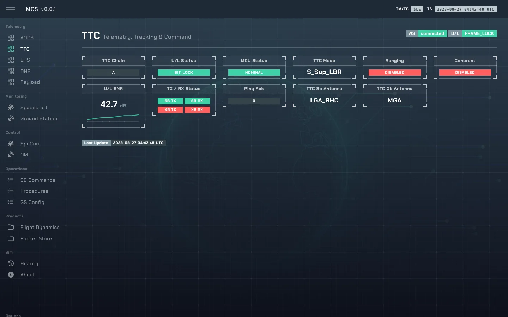

# TTC — Telemetry, Tracking and Command

`TTCMin` in [`so/sys/ttc.py`](../sim-ops-ng-lib/so/sys/ttc.py): the transponder. It computes the
**uplink** budget; the ground station computes the downlink ([ground_station.md](ground_station.md)).
Both follow [rf_link.md](rf_link.md). Bus name `ttc`.

---

## 1. Modes and antennas

A mode name is `<band>_<carrier>_<rate>`:

| Part | Values |
|---|---|
| Band | `S`, `X` |
| Carrier | `Sup` (suppressed, BPSK), `Res` (residual, QPSK), `Sub` (PM subcarrier, uncoded) |
| Rate | `LBR` (~2 W), `HBR` (~5 W, higher bit rate) |

Frequencies, bit rates and coding for each mode are in
[rf_link.md](rf_link.md#41-mode-table). The mode also sets the DHS memory dump rate.

| Antenna | Band | Gain |
|---|---|---|
| `LGA_RHC`, `LGA_LHC` | S | 0 dBi (polarisation matters) |
| `MGA` | X | 15 dBi |
| `HGA` | X | 25 dBi — but selecting it gives no downlink at all in this model |

---

## 2. State

| Field | Default | Meaning |
|---|---|---|
| `ttc_mode` | `S_Sup_LBR` | Active mode. |
| `ttc_chain` | `A` | Redundant chain. |
| `ttc_mcu` | `nominal` | `nominal`, `safe`, `error`. In `error`, only HPTC commands are processed and TM is scrubbed. |
| `ttc_s_antenna`, `ttc_x_antenna` | `LGA_RHC`, `MGA` | |
| `ttc_s_tx_status`, `ttc_s_rx_status` | `on` | S-band transmitter/receiver power (switched by EPS). |
| `ttc_x_tx_status`, `ttc_x_rx_status` | `off` | X-band transmitter/receiver power. |
| `ttc_state_ul` | `NO_RF` | Uplink lock state. |
| `ttc_coherent`, `ttc_ranging` | `disabled` | |
| `ttc_ping_ack` | 0 | Incremented by each ping. |
| `ttc_c_no_ul`, `ttc_eb_no_ul`, `ttc_link_margin_ul`, `ttc_ber_ul`, `ttc_fer_ul`, `ttc_doppler_shift_ul`, `ttc_freq_rx_mhz`, `ttc_freq_tx_mhz` | | Uplink budget. |

---

## 3. Commands

All TTC commands are high-priority (HPTC), see [commanding.md](commanding.md#3-high-priority-commands-hptc).

| Control | Values | TC |
|---|---|---|
| `ttc_mode` | any mode | `TC_TTC_001`–`008` |
| `ttc_chain` | `A`, `B` | `TC_TTC_011`, `012` |
| `ttc_ping` | — | `TC_TTC_021` |
| `ttc_coherent` | `enabled`, `disabled` | `TC_TTC_022`, `023` |
| `ttc_mcu_reboot` | — | `TC_TTC_041` |
| `ttc_s_antenna` | `LGA_RHC`, `LGA_LHC` | `TC_TTC_051`, `052` |
| `ttc_x_antenna` | `MGA`, `HGA` | `TC_TTC_053`, `054` |
| `ttc_ranging` | `enabled`, `disabled` | `TC_TTC_061`, `062` |
| `ttc_mcu` | `nominal`, `safe`, `error` | — (instructor) |

Transmitters and receivers are powered from the EPS ([eps.md](eps.md#2-commands)), which also
power-cycles the MCU (`TC_EPS_042`).
